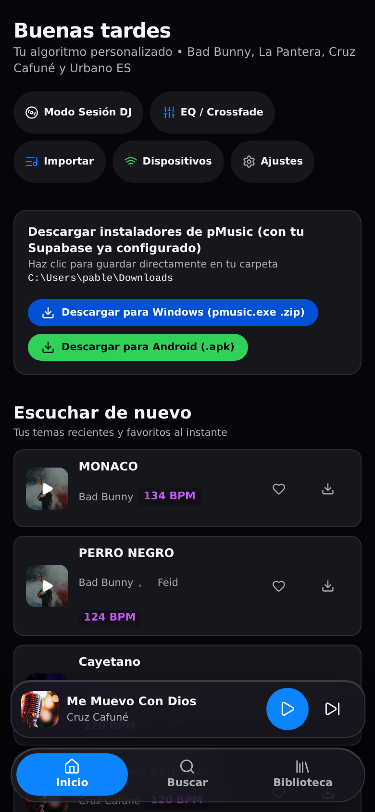
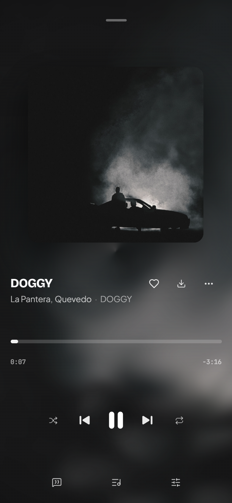

<div align="center">


# pMusic

**Cross-platform OLED Liquid Glass music player for Windows & Android featuring a Dual-Deck Web Audio DJ AutoMix engine, multi-source 15-day release radar, in-splash OTA updates, and zero-cost real-time Supabase sync.**

[](https://github.com/pabloburgos/pMusic/releases/latest)
[](https://github.com/pabloburgos/pMusic/releases/latest)
[](https://github.com/pabloburgos/pMusic/releases/latest)
[](tsconfig.base.json)
[](LICENSE)

[**Latest Release (Windows & Android)**](https://github.com/pabloburgos/pMusic/releases/latest) · [**Web Player**](https://pmusic-olive.vercel.app) · [**Supabase Sync Guide**](docs/GUIA_SUPABASE.md) · [**Windows Guide**](docs/GUIA_WINDOWS.md) · [**Android Guide**](docs/GUIA_ANDROID.md)

</div>

---

## Downloads (`v0.23.12`)

Ready-to-install binaries are published under [**GitHub Releases (`v0.23.12`)**](https://github.com/pabloburgos/pMusic/releases/latest):

| Platform | Asset | Notes |
| :--- | :--- | :--- |
| **Windows (64-bit)** | **`pMusic-Setup-0.23.12.exe`** | Custom standalone installer bundling Electron 45, Discord Rich Presence, loopback stream server, and automatic **in-splash OTA web updates**. |
| **Android** | **`pMusic-Android.apk`** | Signed APK built with native foreground playback service, notification transport controls, offline audio/cover vault, and **in-splash OTA bundle updater**. |
| **Database Schema** | **`supabase-schema.sql`** | Idempotent PostgreSQL schema with RLS policies and Realtime publications for free cross-device cloud sync (`$0/month` on Supabase Free Tier). |

> **Zero-Reinstall OTA Updates:** Once you install Desktop `v0.23.2+` or Android `v0.23.2+`, UI and engine releases ship automatically via `ota/latest.json` directly inside the startup splash screen without requiring manual installer downloads.

---

## Screenshots

### Windows Desktop — OLED Liquid Glass & Personalized Home


### Now Playing (Dynamic Ambient Mesh + Synced Lyrics) & Live Queue / DJ AutoMix
| Now Playing & Synced Lyrics | Fullscreen Queue & DJ AutoMix Studio |
| :---: | :---: |
|  |  |

### Android Mobile — Floating Liquid Glass Shell & Compact Now Playing
| Editorial Home & Floating Navigation | Compact Now Playing Player |
| :---: | :---: |
|  |  |

---

## Core Engineering Features

### 1. OLED Liquid Glass Design System
- **True Obsidian Canvas (`#06060A`)** paired with hardware-accelerated translucent glass chrome (`backdrop-filter: blur(24px) saturate(180%)`), adaptive scrim contrast guards (`>= 4.5:1`), and zero layout-thrashing marquee/backdrop animations.
- **Responsive Across Form Factors:**
  - **Windows PC:** collapsible left sidebar, smooth GPU-composited Now Playing queue with drag-and-drop reordering, Spotlight search (`Ctrl+K`), global media shortcuts, and native **Discord Rich Presence**.
  - **Android Mobile:** native foreground `MediaStyle` notification controls with custom vector transport icons, lock-screen metadata, swipeable mini-player, and edge-to-edge full-screen overlays.

### 2. Dual-Deck Web Audio DJ Engine (`AutoMix`)
- **Two Independent Playback Decks (`Deck A` & `Deck B`)** powered by Web Audio API DSP analysis:
  - Automatic **BPM detection (65–175 BPM)**, RMS energy envelopes, and structural transition markers (*intro*, *drop*, *outro*).
  - **2-opt harmonic queue ordering** to minimize BPM and energy jumps between consecutive tracks.
  - **Three Real-Time Transition Choreographies:** `EQ Swap (200 Hz)` bass cross-modulation, resonant `HPF/LPF` filter sweeps, and BPM-synced `Echo Out` tails.
  - **5-Band Parametric Graphic EQ** (`60 Hz`, `230 Hz`, `910 Hz`, `3.6 kHz`, `14 kHz`) + configurable safe crossfade (`0–12 s`).

### 3. Multi-Source 15-Day Release Radar & Taste Engine (`@pmusic/recommendations`)
- **15-Day Rolling New Releases (`Descubre lo Nuevo`):** aggregates live release signals across **Spotify** (*Novedades Viernes España*, *PEGAO*, *New Music Friday*), **LaHiguera** (*Novedades* & *Canciones*), **iTunes Search ES**, and artist discographies/guest appearances — strictly filtered through your library, liked artists, collaborators, and scene affinity.
- **Deliberate Deluxe-Date Resolution:** preserves single/track-level release dates even when later packaged into deluxe albums or compilations, and surfaces recent guest collaborations on **Última aparición** inside artist profiles.
- **Daily Editorial Mixes:** daily 100-track **Daily Mix** (familiar + fresh balance) and 100-track **Daily Discover** (strictly unheard discoveries).
- **14-Day Half-Life Implicit Learning:** weights early skips (`-1.0`), full listens (`+2.0`), loops (`+3.5`), and explicit likes/library additions (`+5.0`).

### 4. Real-Time Cloud Sync, Social & Offline Mode
- **`pMusic Connect` (`@pmusic/sync`):** millisecond-accurate remote playback transfer and live device control via Supabase Realtime Presence & Broadcast.
- **Social Features:** live **Jam Sessions**, shared collaborative playlists, friend profiles, and yearly **Wrapped** listening stories.
- **Offline Vault & Synced Lyrics:** offline audio + cover caching in IndexedDB / Android Storage and word/line-synced lyrics via **LRCLIB** with Musixmatch fallback.
- **No-Key Playlist Importer:** paste public **Spotify** or **YouTube Music** playlist/album links to import tracks straight into your library.

---

## Monorepo Architecture

```text
pMusic/
├── packages/
│   ├── core/               # Domain models, provider/platform contracts, normalization utilities & design tokens
│   ├── providers/          # Deezer/YouTube catalog adapters, multi-source release radar, HTTP stream Range proxy, LRCLIB & Spotify importer
│   ├── audio-engine/       # Dual-deck Web Audio DJ AutoMix engine, DSP analyzer, transitions & 5-band EQ
│   ├── recommendations/    # 15-day release radar scoring, implicit taste decay, Daily Mix/Discover & search reranking
│   └── sync/               # Supabase Auth + Realtime Connect + offline-first IndexedDB outbox store
├── apps/
│   ├── web/                # Shared React 19 + TypeScript + Tailwind CSS v4 + Zustand UI
│   ├── desktop/            # Windows Electron 45 host (127.0.0.1 loopback server, Discord RPC, OTA updater, custom NSIS/C# setup)
│   └── mobile/             # Android native container (WebView asset loader, foreground service, Gradle/d8/apksigner pipeline & OTA)
├── scripts/                # Cross-platform OTA bundle builder & release automation
├── supabase/               # PostgreSQL schema with RLS policies & Realtime setup
└── ota/                    # Latest web OTA manifest (latest.json) & compressed web bundle
```

---

## Tech Stack

- **Frontend:** React 19, TypeScript 5.9, Vite 7, Tailwind CSS v4, Zustand, Lucide Icons
- **Desktop:** Electron 45, `@xhayper/discord-rpc`, Node HTTP loopback Range server
- **Mobile:** Native Android WebView + `MediaSession` foreground playback service
- **Backend / Sync:** Supabase (Auth, PostgreSQL + RLS, Realtime Presence/Broadcast/Postgres Changes), Vercel Serverless API
- **Testing:** Vitest 4 + React Testing Library (`15` suites, `150+` unit/component tests), Playwright E2E

---

## Local Development & Build

```bash
# 1. Install workspace dependencies (Node >= 22.12 required)
npm install

# 2. Type-check all workspaces and run full unit test suite
npm run typecheck
npm run test

# 3. Build shared web UI & generate OTA bundle
npm run build:web
npm run build:ota

# 4. Build Windows Desktop app & standalone Setup .exe
npm run build:desktop
npm run dist:win

# 5. Build signed Android APK (requires Android SDK Build-Tools)
node apps/mobile/scripts/build-apk.mjs
```

---

## Documentation & Community

- [**Contributing Guide**](CONTRIBUTING.md)
- [**Security Policy**](SECURITY.md)
- [**Supabase Setup Guide**](docs/GUIA_SUPABASE.md)
- [**Windows Build Guide**](docs/GUIA_WINDOWS.md)
- [**Android Build Guide**](docs/GUIA_ANDROID.md)

## License

Released under the [**MIT License**](LICENSE). Copyright © 2026 Pablo Burgos & pMusic Contributors.
