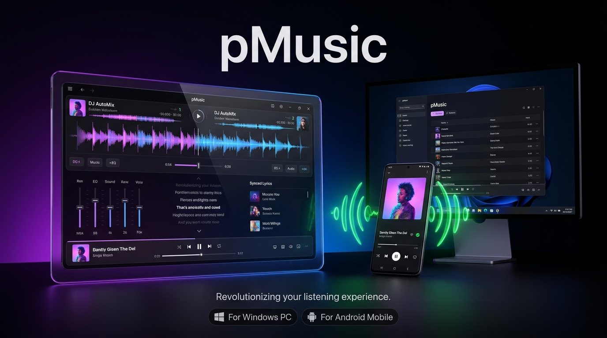
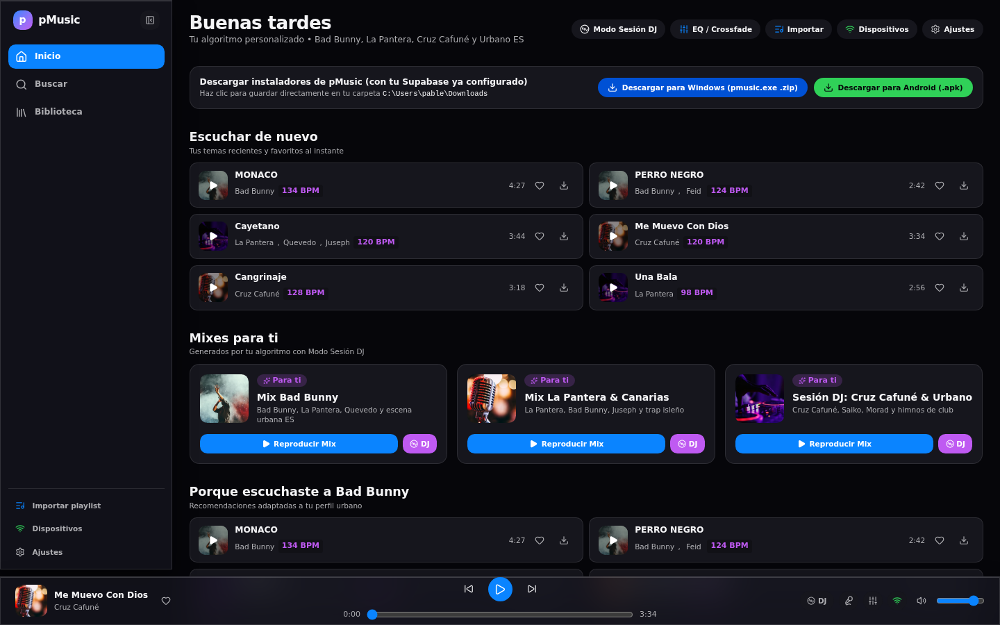
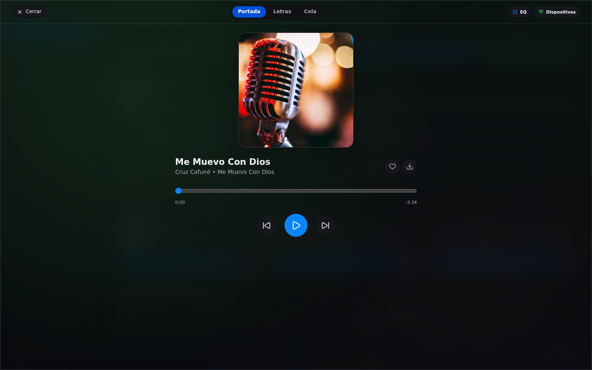
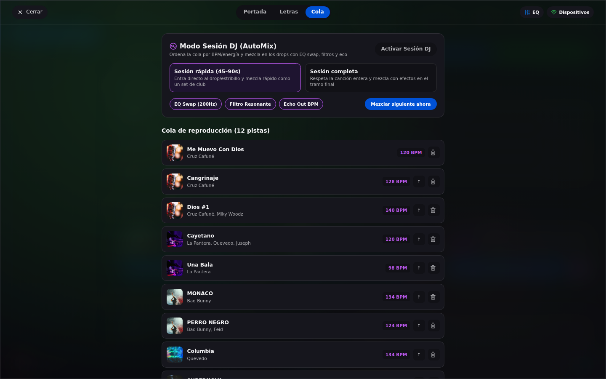

<div align="center">



# pMusic

**Reproductor de música multiplataforma (Windows PC `.exe` + Móvil Android `.apk`) con estética OLED Liquid Glass, Modo Sesión DJ (AutoMix en Web Audio API), algoritmo de recomendaciones enfocado en la escena urbana española y sincronización gratuita en tiempo real (`pMusic Connect`).**

[](https://github.com/pabloburgos/pMusic/releases/tag/v0.1.0)
[](https://github.com/pabloburgos/pMusic/releases/tag/v0.1.0)
[](https://github.com/pabloburgos/pMusic/releases/tag/v0.1.0)
[](#modo-sesión-dj-automix-inteligente)
[](docs/GUIA_SUPABASE.md)

[**Descargar para Windows PC & Android (Releases)**](https://github.com/pabloburgos/pMusic/releases/tag/v0.1.0) • [**Guía Supabase Gratis**](docs/GUIA_SUPABASE.md) • [**Guía Windows**](docs/GUIA_WINDOWS.md) • [**Guía Android**](docs/GUIA_ANDROID.md)

</div>

---

## Descarga Directa (Release `v0.1.0`)

En la sección [**Releases de GitHub (`v0.1.0`)**](https://github.com/pabloburgos/pMusic/releases/tag/v0.1.0) tienes listos para descargar a tu carpeta `Downloads`:

| Plataforma | Archivo en la Release | Cómo usarlo |
| :--- | :--- | :--- |
| **Windows PC (64-bit)** | **`pMusic-0.1.0-Windows-x64.zip`** *(151 MB, portable completo con `pmusic.exe`)* y **`pMusic-Setup-0.1.0.exe`** | Descomprime el `.zip` y haz doble clic en **`pmusic.exe`** (o ejecuta el instalador). Ya incluye tu proyecto de Supabase conectado. |
| **Android (Móvil)** | **`pMusic-Android-0.1.0.apk`** | Descárgalo en tu móvil Android, ábrelo e instálalo. Incluye reproducción en segundo plano y caché offline. |
| **Base de Datos SQL** | **`supabase-schema.sql`** | Script SQL idempotente con las 6 tablas, políticas RLS y publicación en tiempo real para el SQL Editor de Supabase. |

---

## Capturas de Pantalla Reales

### Escritorio Windows (OLED Liquid Glass + Inicio Editorial)


### Reproduciendo Ahora (Now Playing + Malla Ambiental Dinámica) & Modo Sesión DJ (AutoMix)
| Reproduciendo Ahora (Portada & Letras) | Cola & Panel Modo Sesión DJ (AutoMix) |
| :---: | :---: |
|  |  |

### Móvil Android (Barra Flotante Liquid Glass de 3 Pestañas + Mini-Player con Gestos)
<div align="center">
  
</div>

---

## Características Principales

### 1. Diseño OLED Liquid Glass (Auditado con Apple HIG)
* **Tema oscuro profundo OLED (`#06060A`)** con superficies translúcidas **Liquid Glass** (`backdrop-filter: blur(24px) saturate(180%)`) aplicadas exclusivamente al cromo funcional, respetando contraste **WCAG 2.1 AA/AAA** (`>= 4.5:1`) y scrim protector del `38%` sobre portadas brillantes.
* **Adaptativo Móvil y PC:**
  * **Android:** cápsula inferior flotante de 3 pestañas (*Inicio*, *Buscar*, *Biblioteca*) + mini-reproductor flotante con gestos swipe horizontal para cambiar de canción.
  * **Windows PC:** barra lateral izquierda colapsable (`248 px` / `72 px`) + barra de reproducción inferior fija de `80 px` + atajos de teclado globales.
* **Letras Sincronizadas Interactivas (`LRCLIB`):** verso activo en gran formato, desenfoque suave en líneas inactivas y salto instantáneo al segundo exacto al tocar cualquier frase.

### 2. Modo Sesión DJ (AutoMix Inteligente en Web Audio API)
A diferencia de un crossfade convencional, **pMusic** monta una mesa de mezclas virtual con **dos decks independientes (`Deck A` y `Deck B`)**:
* **Análisis DSP de cada pista:** detección automática de **BPM (65–175 BPM)**, envolvente de energía **RMS** y puntos estructurales (*intro*, *drop/estribillo principal* y *outro*).
* **Reordenación armónica 2-opt de la cola:** ordena automáticamente la playlist minimizando saltos de BPM, energía y clave Camelot.
* **Dos modos de sesión en vivo:**
  * **Sesión rápida (45–90 s por tema):** entra justo antes del drop/estribillo y lanza la mezcla al siguiente tema al terminar la parte más fuerte.
  * **Sesión completa:** respeta la duración completa del tema y realiza la mezcla de DJ en el outro.
* **3 Coreografías de Transición con Efectos en Tiempo Real:**
  * **EQ Swap (`200 Hz`):** intercambia progresivamente los subgraves del tema saliente con los del tema entrante sin saturar.
  * **Filtro Resonante (`HPF / LPF`):** barrido de filtro paso-alto/bajo con resonancia suave.
  * **Echo Out Sincronizado al BPM:** cola de eco en pre-fader sincronizada al compás de salida.
* **Crossfade seguro (`0–12 s`) + Ecualizador gráfico de 5 bandas** (`60 Hz`, `230 Hz`, `910 Hz`, `3.6 kHz`, `14 kHz`) con 6 preajustes en español (*Plano*, *Urbano / Graves*, *Vocal*, *Electrónica*, *Acústico*, *Personalizado*).

### 3. Algoritmo de Recomendaciones y Búsqueda (Escena Urbana Española)
* **Semillas preconfiguradas y editables:** **Bad Bunny**, **La Pantera**, **Cruz Cafuné**, **Quevedo**, **Saiko**, **Morad**, **Dellafuente**, **Rels B**, **Mora**, **Feid**, **Eladio Carrión**, **Myke Towers**, **JC Reyes** y **Dei V**.
* **Aprendizaje implícito estilo YouTube con decaimiento temporal (semivida de 14 días):**
  * Salto antes de `20 s` → `-1.0`
  * Escucha completa (`> 80%`) → `+2.0`
  * Repetición / Bucle → `+3.5`
  * *Me gusta* / Añadir a playlist → `+5.0`
* **Inicio Editorial Personalizado:** genera dinámicamente *Escuchar de nuevo*, *Mixes para ti* (con botón directo de *Sesión DJ*), *Porque escuchaste a [Artista]* y *Novedades de tus artistas favoritos*.

### 4. Interconexión PC ↔ Móvil Gratuita (`pMusic Connect` con Supabase)
* **Sincronización en la nube 100% gratis (\$0/mes)** usando **Supabase Free Tier** (PostgreSQL + Auth + Realtime Presence/Broadcast/Postgres Changes).
* **Control remoto en vivo:** pausa, pasa de canción o controla el otro dispositivo desde el panel **Dispositivos**.
* **Transferencia en el segundo exacto:** pasa la canción actual, la cola y el estado del **Modo Sesión DJ** del ordenador al móvil (o viceversa) en 1 toque con compensación automática de latencia.

### 5. Extras Integrados
* **Importador de Playlists sin claves API:** pega cualquier enlace público de playlist o álbum de **Spotify** o **YouTube Music** para importarlo a tu biblioteca.
* **Modo Offline / Caché de Canciones:** descarga pistas para escucharlas sin conexión de datos en el móvil.
* **Discord Rich Presence en Windows:** muestra lo que estás escuchando en tu perfil de Discord.

---

## Arquitectura del Monorepo

```text
pMusic/
├── packages/
│   ├── core/               # Tipos de dominio, contratos congelados, semillas ES y tokens WCAG/HIG
│   ├── providers/          # Adaptador YouTube Music (gl=ES), LRCLIB, parser LRC, importador Spotify/YT y proxy Range 206
│   ├── audio-engine/       # Motor Web Audio Dual-Deck, analizador DSP BPM/RMS/Drop, planificador DJ y EQ de 5 bandas
│   ├── recommendations/    # Motor de señales implícitas, decaimiento de 14 días, autocompletado y estantes editoriales
│   └── sync/               # Motor Supabase Auth + Realtime (Presence/Broadcast/Postgres) + almacén local con Outbox offline
├── apps/
│   ├── web/                # Interfaz compartida React 19 + Tailwind CSS v4 + Framer Motion + Zustand
│   ├── desktop/            # App Windows PC (Electron 45 + servidor loopback 127.0.0.1 + Discord RPC + NSIS/ZIP)
│   └── mobile/             # App Android (Capacitor 8 + PMusicPlaybackService + PMusicStreamProxy + Gradle APK)
├── supabase/
│   ├── schema.sql          # Esquema PostgreSQL completo e idempotente con RLS y publicación Realtime
│   └── seed_optional.sql   # Función SQL opcional para precargar semillas urbanas españolas
└── docs/                   # Guías detalladas en español (Supabase, Windows y Android)
```

---

## Desarrollo y Compilación Local

```bash
# 1. Instalar dependencias
npm install

# 2. Verificar tipos y ejecutar tests unitarios (63 tests)
npm run typecheck
npm run test

# 3. Compilar interfaz web compartida
npm run build:web

# 4. Compilar aplicación de escritorio Windows
npm run build:desktop
npm run dist:win

# 5. Compilar paquete APK para Android
npm run build:apk

# 6. Ejecutar suite E2E con Playwright y auditoría Apple HIG
npm run test:e2e
```

---

## Documentación Paso a Paso

* [**Guía de Base de Datos y Sincronización Gratuita (Supabase)**](docs/GUIA_SUPABASE.md)
* [**Guía de Instalación y Compilación en Windows PC (`.exe`)**](docs/GUIA_WINDOWS.md)
* [**Guía de Instalación y Compilación en Android (`.apk`)**](docs/GUIA_ANDROID.md)
